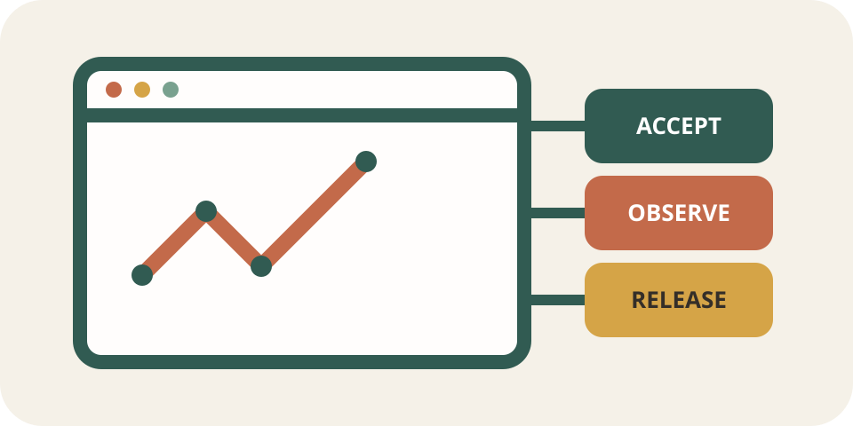

<div align="center">
  
  <h1>Product Site Engineering Skill</h1>
  <p><strong>陪你把一个还没想清楚的网站想法，走到可以验证、上线和持续改进的产品。</strong></p>
  <p>从想法、调研、需求和设计开始，连接前后端、测试、日志、发布、反馈与 bad-case 记忆。</p>
  <p>
    <a href="https://github.com/ma401-lang/product-site-engineering-skill/actions/workflows/validate.yml"></a>
    <a href="LICENSE"></a>
    <a href="https://github.com/ma401-lang/product-site-engineering-skill/releases/tag/v1.2.0"></a>
  </p>
</div>

## 它能帮你完成什么

你可能只有一句话：“我想做一个五分钟就能完成的测评，结果还要在后续使用中慢慢修正。”这时直接写页面很容易把早期猜测变成产品事实。做到一半，导航、题目、数据结构和 AI 提示各自发展；等用户说“不好用”，团队又很难找到问题究竟来自需求、设计、代码还是模型。

使用这个 Skill 后，Agent 会先保留你的原始想法，列出真正会改变产品方向的问题，再用访谈、竞品、标准、现有数据或小型原型补证据。确定需求和设计时，每个重要选择都能追溯到想法或研究结果。进入开发后，它会继续检查前端状态、API、数据、日志、AI 行为、部署和回滚。测试中任何让你不满意的结果都会进入 `BAD_CASES.md`，并绑定一个回归检查。几周后再次改产品时，Agent 仍然知道哪些错误已经发生过、当时怎样修、为什么不能再出现。

最终会同时得到可运行页面和一条可以复查的产品推理链：

```text
原始想法
  → 用户与问题调研
  → 需求选择与设计假设
  → 冻结 benchmark
  → 验收场景
  → 前后端实现
  → 测试与 bad cases
  → 预览、上线与回滚
  → 真实反馈
  → 下一版 benchmark
```

这条链适合新网站、已有产品改版、框架或云平台迁移，也适合带 AI 对话、知识库、长期记忆或高敏感数据的产品。

## Benchmark 从想法阶段就开始

这里的 benchmark 是一份会随产品演进、但不能事后篡改的方向记录。它先回答“为什么值得做、还不知道什么、用什么方法弄清楚”，再记录参考产品和标准、当前基线、反例、质量权重与目标。

每个项目的 `BENCHMARK.md` 会保留四层信息：

1. 原始想法、已知事实、假设、未知问题和风险最大的判断。
2. 产品调研的问题、方法、来源、发现、可信度、局限以及对决策的影响。
3. 需求和设计选择，它们分别由哪些想法或证据支持，哪些备选方案被放弃。
4. 当前产品基线、外部参考、anti-benchmark、测量方法和验收 ID。

方向改变时先升级 benchmark，再调整需求、设计和代码。旧版本继续保留，因此可以看出产品真的进步了，还是评价标准被临时改低了。

## Bad cases 是产品的长期记忆

AI 很容易在一次对话里记住教训，换一轮任务后又犯同样的问题。测试报告和聊天记录也常常只留下“已修复”，没有留下原始场景与预防机制。

工作台里的 `BAD_CASES.md` 专门保存这些问题。以下情况都会进入记录：

- 自动化测试、人工测试、可用性测试或安全检查出现有意义的失败；
- 产品负责人或用户明确表示结果不满意；
- AI 输出违反内容、事实、记忆或安全边界；
- 线上故障造成用户可见的问题；
- 已经处理过的问题再次出现。

每条 bad case 都包含触发场景、期望结果、实际结果、严重程度、责任层、负责人、回归或评测 ID、预防机制、解决证据和复发次数。P0 问题没有验证通过时，发布审计会阻止把它描述成可上线状态。再次复发时继续更新原记录，并说明上一次防线为什么没有拦住。

## 可以直接配合的外部网站 Skills

下面列出的都是实际存在的开源 Skill 或 Skill 集合。它们各自保持独立来源，方便查看许可证、版本和更新记录；本仓库负责把它们放进同一条产品交付链，不会把第三方的可变内容悄悄复制成自己的规则。

| 产品阶段 | Skill 与作者 | 直接使用它解决什么 | 如何与本 Skill 配合 |
|---|---|---|---|
| 想法澄清 | [`brainstorming`](https://github.com/obra/superpowers/blob/main/skills/brainstorming/SKILL.md)，Jesse Vincent / obra 与 Prime Radiant contributors | 追问动机、已有尝试、喜欢和讨厌的案例，把模糊想法写成可讨论的设计 | 将结论写入 benchmark 的想法、研究和决策区，再由本 Skill 管理后续证据 |
| 实施规划 | [`writing-plans`](https://github.com/obra/superpowers/blob/main/skills/writing-plans/SKILL.md)，Jesse Vincent / obra 与 Prime Radiant contributors | 把批准后的设计拆成带文件、测试和验证步骤的小任务 | 等 benchmark、需求和设计方向冻结后使用 |
| 视觉设计 | [`frontend-design`](https://github.com/anthropics/claude-code/blob/main/plugins/frontend-design/skills/frontend-design/SKILL.md)，Anthropic；Prithvi Rajasekaran、Alexander Bricken | 建立与产品内容相符的字体、版式、色彩和动效方向，减少模板感 | 把选定方向记录为设计假设，再接受可访问性、性能和资产保护检查 |
| 设计系统探索 | [`ui-ux-pro-max`](https://github.com/nextlevelbuilder/ui-ux-pro-max-skill)，nextlevelbuilder | 搜索产品类型、设计系统、配色、字体、交互模式和多框架实现参考 | 用来比较候选方案，最后只保留一个经过 benchmark 约束的方向 |
| 界面审查 | [`web-design-guidelines`](https://github.com/vercel-labs/agent-skills/blob/main/skills/web-design-guidelines/SKILL.md)，Vercel | 审查 UI、交互和无障碍问题 | 把发现转成当前项目的验收 ID 和 bad case，再用本项目测试验证 |
| React 性能 | [`react-best-practices`](https://github.com/vercel-labs/agent-skills/tree/main/skills/react-best-practices)，Vercel | 按影响程度检查 React 与 Next.js 性能问题 | 仅在技术栈匹配时使用，并用改动前后的同一场景测量结果 |

具体组合顺序、信任边界和适用场景见 [external-skill-integration.md](product-site-engineering/references/external-skill-integration.md)。更多经过标注的教程、标准和作者信息见 [website-building-resources.md](product-site-engineering/references/website-building-resources.md)。

## 它会留下哪些可用成果

| 你正在做的事 | 工作台留下的成果 |
|---|---|
| 从想法判断要不要做 | 研究问题、证据来源、发现、可信度和决策影响 |
| 把调研变成产品 | 需求与设计追踪、非目标、保护资产、稳定验收 ID |
| 开发完整用户流程 | 空状态、加载、成功、失败、超时、重试、取消、重复提交与存储故障 |
| 连接前端、后端和数据 | 输入校验、鉴权、限流、幂等、错误协议、迁移和用户/租户隔离 |
| 看见线上发生了什么 | 前端事件和后端日志白名单、request ID、看板、告警和运行手册 |
| 构建 AI 功能 | 服务端提示、知识来源、记忆同意、确定性护栏、评测与 bad cases |
| 上线或迁移 | 预览检查、区域实测、发布标识、数据兼容、回滚演练和生产证据 |
| 持续改进 | 脱敏反馈、bad-case 复发记录、回归检查和下一版 benchmark |

所有公开按钮都必须真的工作、清楚说明暂不可用，或从发布版本中移除。日志默认排除聊天正文、表单正文、Cookie、令牌、完整 IP、原始邮箱和私有提示。

## 开始使用

将仓库中的 `product-site-engineering/` 安装到 Agent Skills 目录。在 Codex 的常见本地配置中可以放到 `~/.codex/skills/product-site-engineering/`。安装方式仍应以当前工具的官方说明为准。

从一个新想法开始，可以这样说：

```text
使用 $product-site-engineering。我现在只有一个网站想法，请先帮我保留原始意图，
列出会改变产品方向的未知问题，完成必要调研，再一起确定需求、设计和 benchmark。
```

改造已有网站时，可以这样说：

```text
使用 $product-site-engineering。先读取现有产品和保护资产，建立改动前基线，
把这次改版做成完整纵向切片。所有不满意的测试结果都写入 BAD_CASES.md 并增加回归检查。
```

项目还没有工程工作台时，可运行：

```bash
python3 product-site-engineering/scripts/init_workbench.py \
  --target /absolute/path/to/project \
  --project "My Product"
```

普通审计允许 benchmark 仍在调研阶段：

```bash
python3 product-site-engineering/scripts/audit_workbench.py \
  --target /absolute/path/to/project
```

准备发布时运行严格审计：

```bash
python3 product-site-engineering/scripts/audit_workbench.py \
  --target /absolute/path/to/project \
  --release
```

严格审计会检查 benchmark 是否冻结、负责人和参考来源是否完整、权重是否为 100、验收 ID 是否存在、bad-case 结构是否完整，以及是否还有未解决的 P0 bad case。

## 仓库结构

```text
product-site-engineering-skill/
├── README.md
├── BENCHMARK.md
├── BAD_CASES.md
├── product-site-engineering/
│   ├── SKILL.md
│   ├── references/
│   ├── assets/workbench/
│   │   ├── BENCHMARK.md
│   │   ├── BAD_CASES.md
│   │   └── ...
│   ├── assets/examples/typescript/
│   ├── scripts/
│   └── agents/openai.yaml
├── tests/
└── .github/workflows/validate.yml
```

`SKILL.md` 负责主流程和边界，`references/` 保存按需加载的专业知识，`assets/workbench/` 提供可复制的产品记录，`scripts/` 把关键门禁变成可重复检查。这样的拆分遵循 [OpenAI Skills 指南](https://developers.openai.com/api/docs/guides/tools-skills)的渐进披露原则。

## 验证

```bash
python3 product-site-engineering/scripts/validate_skill.py .
python3 -m unittest discover -s tests -v
```

GitHub Actions 会在 push 和 pull request 时运行同样的检查。发布包还会验证 Skill 元数据、必需资源、脚本语法、文件数量与大小限制，以及日志 schema 的字段白名单。

首页结构参考了 HKUST DIAL、Yuyu Luo 发起的 [Supervisor-Skills](https://github.com/HKUSTDial/Supervisor-Skills)，重点学习它如何先讲清项目价值，再给出能力、结构和开始方式。本站没有加入新闻或社区板块。

仓库只保存通用方法、脚本和无敏感数据模板，不包含 Psyche Guide 的私有提示词、用户对话或业务数据。

## License

MIT
